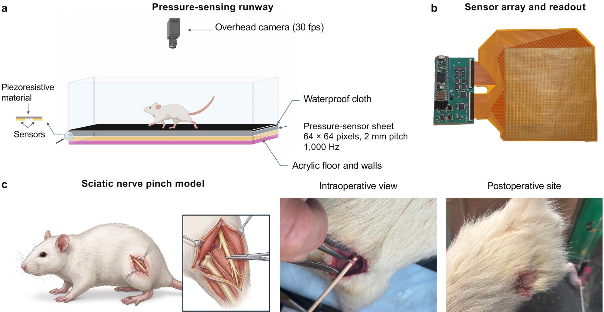
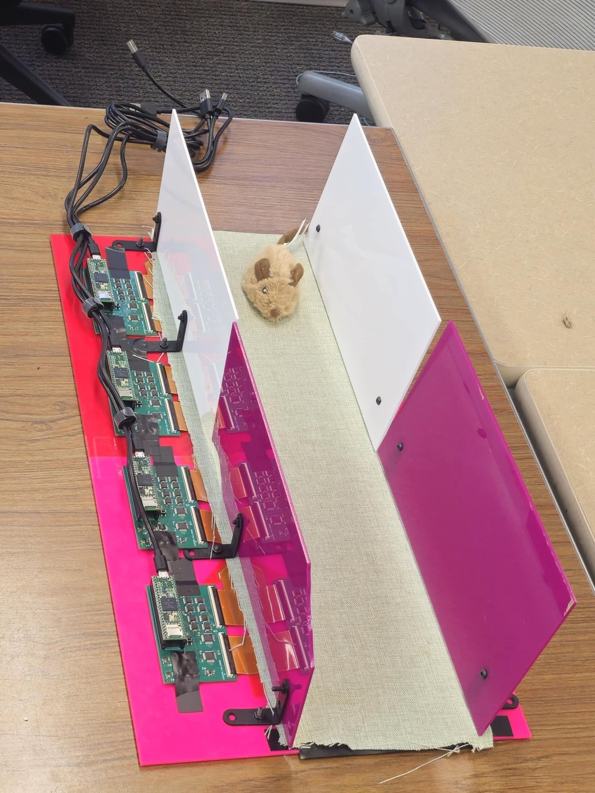
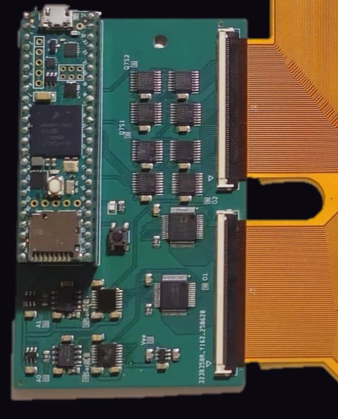
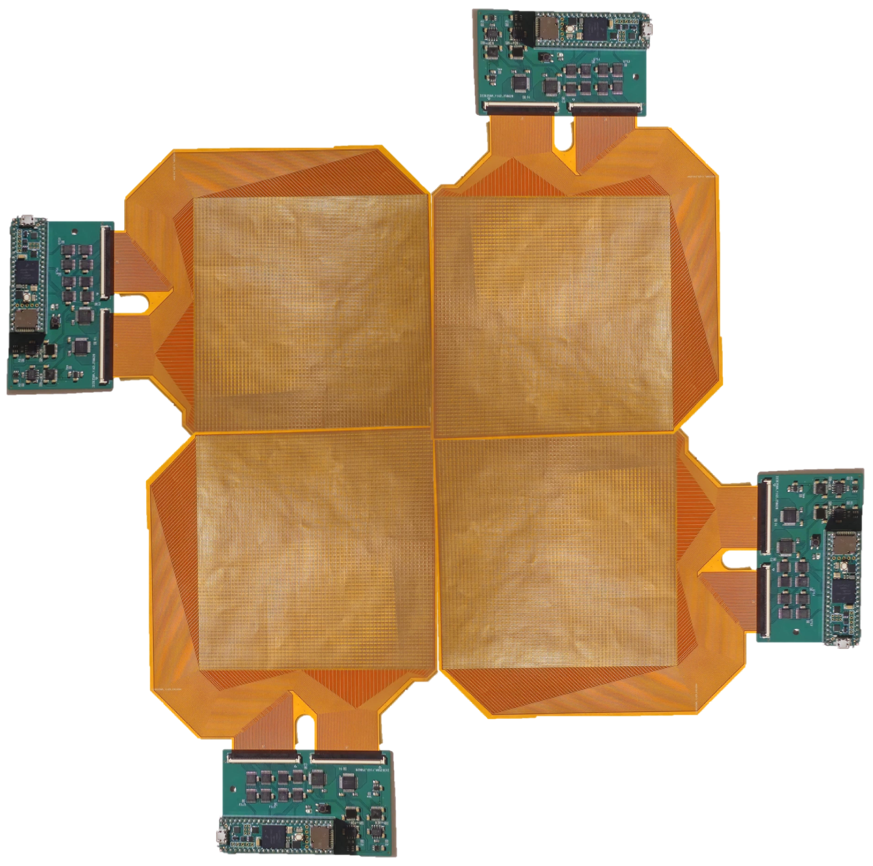
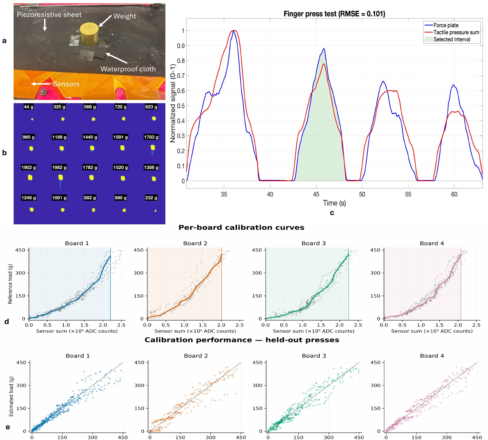
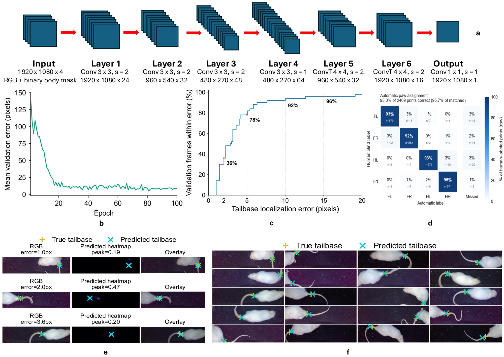

# How it works

TactileArena measures contact directly. The floor is a pressure image sensor, read fast enough
to follow load within a single step, and recorded on the same clock as an ordinary overhead camera.

## The sensing surface { #surface }

Each **module** is a flexible printed circuit with a 64&nbsp;&times;&nbsp;64 grid of electrode pairs at 2&nbsp;mm
pitch: 4,096 tactile pixels, or *taxels*, over 128&nbsp;&times;&nbsp;128&nbsp;mm. A sheet of piezoresistive film lies
on top. Where something presses, the film's resistance drops between the electrodes beneath it. A waterproof
cloth covers the stack, so the animal never touches the electronics.

Each module has its own **readout board** (a Teensy 4.1 microcontroller with analog multiplexers and
analog-to-digital converters), which plugs directly into the module's flexible tail. Four modules side by side
make the 64&nbsp;&times;&nbsp;256-taxel runway: 16,384 taxels over 512&nbsp;&times;&nbsp;128&nbsp;mm, inside clear walls
and under an overhead camera.

Because each module is read independently, the modules can also be arranged into other shapes, such as a square
open field (a [demonstration](index.md#beyond) not analysed in the paper).

<figure class="ta-fig" markdown>
{ loading=lazy }
<figcaption><strong>The runway.</strong> An overhead camera above a 64&nbsp;&times;&nbsp;256-taxel pressure sheet (four modules) under a waterproof cloth. Panel b shows one module and its readout board. From the manuscript.</figcaption>
</figure>

<figure class="ta-card" markdown>
{ loading=lazy }
<figcaption>The assembled runway: four modules under the cloth between the walls, their four readout boards along one side (toy mouse for scale).</figcaption>
</figure>
<figure class="ta-card" markdown>

{ loading=lazy }

<figcaption>A readout board: a Teensy 4.1, shift registers that drive the rows, multiplexers and ADCs that read the columns, and two connectors for the sensor's tails.</figcaption>
</figure>
<figure class="ta-card" markdown>

{ loading=lazy }

<figcaption>Four modules tiled 2&nbsp;&times;&nbsp;2 instead of in a row.</figcaption>
</figure>

## Reading 16,384 taxels a thousand times a second { #sampling }

A conventional pressure mat reads every taxel in turn, so a bigger or denser mat is a slower one. But a walking
animal touches only a few percent of the floor at any moment. TactileArena's readout firmware spends its
measurements where the contacts are (adaptive compressive sampling; [Slepyan et al., 2024](https://arxiv.org/abs/2410.13847)).

In every frame, each board reads a fixed budget of **M taxels** (M&nbsp;=&nbsp;200, 4.9% of the module, in the
paper's recordings), in this order:

1. **Follow ongoing contacts.** Taxels that triggered neighbourhood sampling in the previous frame are read first.
2. **Watch the rest of the module.** The remaining budget walks a fixed coarse-to-fine background pattern. It
   starts at the module centre and continues through grids of halving pitch (32, 16, 8, 4 and 2 taxels), so even
   an unfinished scan covers the module evenly. The pattern shifts by one column every frame (and one row after
   every full sweep), so over successive frames every taxel gets read.
3. **Zoom in on anything pressed.** Whenever a reading exceeds the threshold T, the unread taxels in its
   3&nbsp;&times;&nbsp;3 neighbourhood are read, and so on recursively. A paw is therefore captured at full resolution,
   out to a ring of unloaded taxels around it.

Each taxel is read at most once per frame, and every reading is sent to the computer, including those below
threshold. In the paper's recordings (M&nbsp;=&nbsp;200, T&nbsp;=&nbsp;700 ADC counts) each board produced a frame
roughly every millisecond.

### Try it: press the module { #simulator }

The left panel is the pressure actually on the module, a simulated paw that follows your pointer (press and drag;
when nobody is pressing, two paws walk across by themselves). The right panel shows only what the board read in
the current frame, using the same loop as the firmware.

  

    <figure><canvas data-view="true" aria-label="Simulated true pressure on one 64 by 64 module"></canvas><figcaption>True pressure (hidden from the board)</figcaption></figure>
    <figure><canvas data-view="read" aria-label="Taxels the firmware read in the current frame"></canvas><figcaption>What the board read this frame</figcaption></figure>
  

  

    Loading&hellip;
  

  

    <label>Budget M <input type="range" name="M" min="40" max="1200" step="10" value="200"><output name="M">200</output></label>
    <label>Threshold T <input type="range" name="thr" min="200" max="2500" step="50" value="700"><output name="thr">700</output></label>
    <button type="button" data-act="play" aria-pressed="false">Pause</button>
  

  

    not read this frame
    read, below threshold
    read, pressed
  

Things to try: lower **M** and watch the background scan get sparser while the paw is still read completely;
raise **T** and the board stops expanding around light contacts. The simulation shows about 30 frames per second.
The real boards run near 1,000.

### The real thing, frame by frame { #replay }

This is the recording itself: for each of the four boards, exactly which taxels it read in its most recent frame,
during 0.6&nbsp;s of a rat walking (24 February 2026, rat 4, before surgery).

  <canvas aria-label="The runway's four modules: which taxels each board read in its latest frame, from a real recording"></canvas>
  

    <button type="button" data-act="play" aria-pressed="false">Play</button>
    <button type="button" data-act="step">Next frame</button>
    <label>Speed <select name="speed">
      <option value="0.01">1/100&times;</option>
      <option value="0.04" selected>1/25&times;</option>
      <option value="0.25">1/4&times;</option>
    </select></label>
    <label><input type="checkbox" name="showread" checked> show taxels read below threshold</label>
  

  
Loading&hellip;

Each board's coarse background scan visibly reaches a finer level when it has no contacts to follow, because
the budget it does not spend on a paw goes to the scan.

### What the budget trades { #budget }

M and T are sent to each board at the start of a recording, so the trade-off is set in software, not hardware.
A smaller M gives more frames per second with less background coverage per frame, and a larger M the reverse.
The threshold sets how light a touch counts as contact. An amplifier gain (digital potentiometer) sets
sensitivity for the expected loads. The nominal 1&nbsp;kHz frame rate is therefore a property of the paper's
configuration, not a fixed limit.

## From readings to force { #calibration }

Raw taxel readings are converted to load with board-specific calibration curves. Each module was pressed through
the same waterproof cover onto an independent force plate (three load cells and a 24-bit amplifier). The summed
tactile response followed the force plate's loading and unloading (RMSE&nbsp;0.101 between independently normalized
signals). Piecewise-cubic curves, one per board, map summed responses to mass-equivalent load between 0 and about
410&ndash;421&nbsp;g.

Tested on presses held out of the fit, the curves predicted load with RMSE of 23.4&ndash;30.6&nbsp;g, roughly
5&ndash;8% of the body mass of the rats studied. Absolute loads are therefore approximate; the nerve-injury
analyses normalize by body mass and compare each animal with its own pre-surgery baseline.

<figure class="ta-fig" markdown>
{ loading=lazy }
<figcaption><strong>Characterization.</strong> Tactile vs force-plate response, per-board calibration curves (d) and held-out-press predictions (e). Supplementary Fig. S1 of the manuscript.</figcaption>
</figure>

## From pressure and video to paw-resolved gait { #pipeline }

<figure class="ta-fig" markdown>
{ loading=lazy }
<figcaption><strong>The analysis pipeline</strong> (Fig. 1 of the manuscript). A1, a pressure frame as acquired; black taxels were not read in that frame. A2, overhead video. B, tail-base localization. C, registered fusion. D, paw assignment. E, footstep extraction.</figcaption>
</figure>

1. **One clock.** Pressure packets from the four boards and frames from the overhead cameras are timestamped against
   the same host clock, from a shared start signal.
2. **Pressure frames.** Each board's most recent packet becomes a 64&nbsp;&times;&nbsp;64 image (taxels it did not read
   were below threshold in recent frames and are set to zero), and the four are joined into the 64&nbsp;&times;&nbsp;256
   runway map.
3. **Camera in sensor coordinates.** A projective transform, from the platform corners marked once per recording,
   maps each video frame onto the taxel grid. Background subtraction gives the body mask.
4. **Body orientation.** A small encoder&ndash;decoder network finds the tail base from the image and body mask; the
   tail-base-to-centroid vector gives the body's heading.
5. **Contacts and paws.** Pressure contacts are tracked across frames, split and merged into stance events, and
   scored for each paw from their position relative to the smoothed whole-animal centre of pressure and walking
   direction. Camera-derived votes add a weighted contribution, and a Viterbi decoder enforces sensible left/right
   sequences.

Within hand-selected walking windows from 81 recordings, the pipeline found and correctly labelled **2,303 of
2,469** hand-labelled contacts (93.3%; 95.7% of the contacts it matched). Walking-window selection and
camera-corner marking are still manual.

<figure class="ta-fig" markdown>
{ loading=lazy }
<figcaption><strong>Tail-base localization and paw-assignment accuracy</strong> (Supplementary Fig. S2). Panel d is the confusion matrix for all 2,469 hand-labelled contacts.</figcaption>
</figure>

### Measures computed for every contact { #measures }

| Measure | What it is |
|---|---|
| Stance, stride, duty factor | onset and lift-off of each paw; duty factor = stance / stride |
| Contact area and shape | area of the thresholded print (4&nbsp;mm² per taxel), length-to-width ratio |
| Peak and time-integrated load | summed response per contact, calibrated to mass-equivalent grams, and its integral over stance |
| Centre of pressure (COP) | pressure-weighted centroid, for the whole animal or within one paw |
| Interlimb ratios and imbalance | e.g. left/right hindpaw duty-factor and loading ratios; (L&minus;R)/(L+R) during hindpaw-only support |

The [Software](software.md) page explains how to run the pipeline. The manuscript's Methods give every
parameter.

## Limits worth knowing { #limits }

- The film measures **normal** pressure. Braking, propulsion and other shear forces are not measured; COP motion is not a substitute.
- Calibration was done per board on summed responses, not per taxel. Absolute loads carry errors of about 23&ndash;31&nbsp;g.
- A 2&nbsp;mm pitch resolves a rat's paw pads; smaller animals would need finer-pitch sensors.
- Paw assignment was validated in walking bouts. Turning, overlapping contacts and long spontaneous behaviour need further validation.
