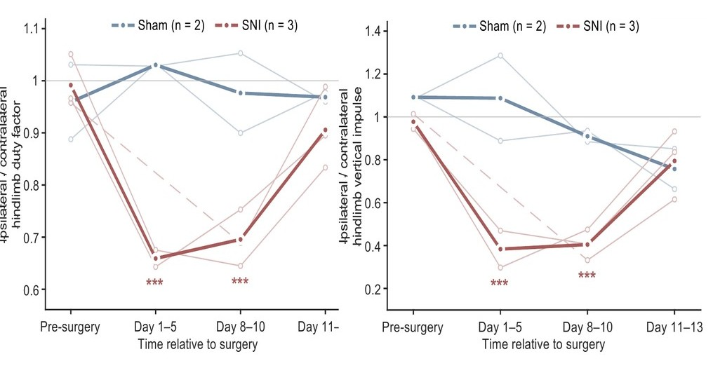
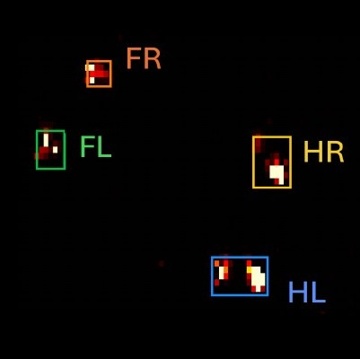

# TactileArena

<!--
  Home page. Layout classes live in docs/stylesheets/tactilearena.css.
  Numbers here come only from the manuscript (Gait_Project_Paper, main 4.0.tex) and its figures.
-->

<section class="ta-section" markdown>
<p class="ta-kicker">Concept</p>

## Contact forces complement video-based behavioral measurement { #idea }

<div class="ta-story ta-story--flip" markdown>
<div class="ta-story__text" markdown>

Viewed from above, the paws of a walking rat are largely hidden beneath its body. Video and pose estimation
describe the position and movement of the body, but not the load supported by each paw.

TactileArena measures the interaction directly at the surface. The floor is a dense array of pressure-sensing
elements (taxels), so that every contact is recorded as a pressure image of the paw throughout stance. Overhead
video, recorded on the same clock, provides body position and orientation; the tactile floor provides the contact
loading.

Each recording provides the spatiotemporal parameters measured by conventional gait-analysis platforms such as
CatWalk, including paw placement and stance and swing timing. It also provides quantities that video cannot
capture: the load borne by each paw, the redistribution of weight among the paws, and the progression of load
across each paw during stance.

</div>
<figure class="ta-media" markdown>
<span class="ta-badge">Recorded data · 0.25× speed</span>
<video width="1920" height="1084" data-loop muted loop playsinline preload="none" data-poster="assets/loops/floor_and_camera.jpg"
       aria-label="Top: overhead video of a walking rat whose paws are hidden beneath its body. Bottom: the same instant on the tactile floor, where each paw appears as a distinct, labelled pressure contact.">
  <source src="assets/loops/floor_and_camera.mp4" type="video/mp4">
</video>
</figure>
</div>

<p class="ta-small">Simultaneous overhead video (top) and tactile floor (bottom) of the same walking sequence, both
registered to sensor coordinates. Labels indicate automatic paw assignments by the analysis pipeline:
<span class="ta-paw ta-paw--FL">FL</span>, left forepaw; <span class="ta-paw ta-paw--FR">FR</span>, right forepaw;
<span class="ta-paw ta-paw--HL">HL</span>, left hindpaw; <span class="ta-paw ta-paw--HR">HR</span>, right hindpaw.</p>

<div class="ta-numbers">
  <div class="ta-number"><b>16,384</b><span>taxels in four 64&nbsp;&times;&nbsp;64 modules</span></div>
  <div class="ta-number"><b>2&nbsp;mm</b><span>taxel pitch, resolving the plantar contact geometry of the rat paw</span></div>
  <div class="ta-number"><b>512&nbsp;&times;&nbsp;128</b><span>mm runway sensing area</span></div>
  <div class="ta-number"><b>~1&nbsp;kHz</b><span>nominal frame rate, resolving load dynamics within individual steps</span></div>
  <div class="ta-number"><b>4.9%</b><span>of each module's taxels measured per frame (200 of 4,096), concentrated on active contacts</span></div>
</div>
</section>

<section class="ta-section" markdown>
<p class="ta-kicker">Biological application</p>

## Contact loading reveals deficits underestimated by gait timing { #why }

<div class="ta-story ta-story--top" markdown>
<div class="ta-story__text" markdown>

Rats were followed for two weeks after a left sciatic nerve pinch (three injured, two sham-operated). During the
first postoperative days, injured animals continued to place the affected hindpaw on the ground. The reduction in
its share of stance time was moderate, whereas the reduction in the load it supported was substantially larger.

<div class="ta-finding">
  <div class="ta-finding__card"><b>&minus;0.33</b><span><em>Gait timing.</em> Change in the left-to-right hindpaw duty-factor ratio, days 1&ndash;5 after surgery.</span></div>
  <div class="ta-finding__card ta-finding__card--touch"><b>&minus;0.59</b><span><em>Contact loading.</em> Change in the left-to-right hindpaw time-integrated loading ratio, days 1&ndash;5 after surgery.</span></div>
</div>

Both ratios are close to 1 at baseline: the duty-factor ratio therefore decreased by approximately one third,
whereas the loading ratio decreased by approximately 60%. Peak loading of the injured hindpaw decreased by 27%,
and that of the contralateral hindpaw increased by 22&ndash;23%. Both ratios returned toward baseline by days
11&ndash;13.

<p class="ta-small">Model estimates from linear mixed-effects models (p&nbsp;&lt;&nbsp;0.001 for both ratio changes). Statistical details are given in <a href="results/#injury">Results</a>.</p>

</div>
<figure class="ta-fig" markdown>
{ loading=lazy }
<figcaption>Left-to-right hindpaw duty-factor ratio and time-integrated loading ratio before and after surgery in sham-operated and nerve-injured rats. Adapted from Fig. 5d of the manuscript.</figcaption>
</figure>
</div>
</section>

<section class="ta-section" markdown>
<p class="ta-kicker">Sensing architecture</p>

## Large-area, high-density sensing at kilohertz rates { #how }

Large pressure-sensing surfaces conventionally trade sensing area and spatial resolution against acquisition
speed, because every taxel must be measured in each frame. TactileArena overcomes this trade-off with adaptive
compressive sampling: each readout board measures a fixed subset of taxels per frame, resolving at full density
every region whose readings exceed a configurable pressure threshold, while a sparse background scan monitors the
remainder of the surface.

<div class="ta-cards" markdown>
<div class="ta-card" markdown>
<div class="ta-media ta-media--contain" markdown>{ loading=lazy }</div>
<div class="ta-card__body" markdown>
<span class="ta-card__num">01 · SENSING SURFACE</span>

### Modular sensor arrays

Each module is a flexible printed circuit carrying a 64&nbsp;&times;&nbsp;64 electrode array beneath a
piezoresistive film and a waterproof cover; applied pressure reduces the local resistance of the film. Four
modules, each with a dedicated readout board, form the 512-mm runway.
</div>
</div>
<div class="ta-card" markdown>
<div class="ta-media" markdown>
<video width="512" height="512" data-loop muted loop playsinline preload="none" data-poster="assets/loops/sampling.jpg" aria-label="Taxels measured by one module in successive frames: a sparse, shifting background scan and dense sampling around each paw contact.">
  <source src="assets/loops/sampling.mp4" type="video/mp4">
</video>
</div>
<div class="ta-card__body" markdown>
<span class="ta-card__num">02 · ADAPTIVE SAMPLING</span>

### Adaptive compressive sampling

Each readout board measures 200 of its 4,096 taxels per frame. A coarse-to-fine background scan, shifted every
frame, monitors the full module; any reading above the pressure threshold triggers recursive full-resolution
sampling of its neighbourhood, so that each contact is resolved completely while unloaded regions are sampled
sparsely.

[Interactive demonstration](how-it-works.md#sampling){ .ta-more }
</div>
</div>
<div class="ta-card" markdown>
<div class="ta-media" markdown>{ loading=lazy }</div>
<div class="ta-card__body" markdown>
<span class="ta-card__num">03 · VIDEO FUSION</span>

### Camera-assisted paw assignment

Overhead video is recorded on the same clock and registered to the sensor grid, and a convolutional network
localizes the tail base to provide body orientation. Contacts are then assigned to individual paws, correctly
identifying 93.3% of 2,469 manually annotated contacts.

[Analysis pipeline](how-it-works.md#pipeline){ .ta-more }
</div>
</div>
</div>
</section>

<section class="ta-section" id="overview" markdown>
<p class="ta-kicker">Overview video</p>

## Overview

<figure class="ta-media" markdown>
<video width="1920" height="1080" controls preload="none" playsinline data-poster="assets/video/overview.jpg"
       aria-label="Overview video of TactileArena with on-screen captions">
  <source src="assets/video/overview.mp4" type="video/mp4">
  <track kind="captions" src="assets/video/overview.vtt" srclang="en" label="English">
</video>
</figure>
</section>

<section class="ta-section" markdown>
<p class="ta-kicker">Measurements</p>

## From whole-animal to within-step scales { #measures }

Each recording supports measurements at three scales: displacement along the arena, load distribution among the
four paws, and pressure dynamics within each paw contact.

<div class="ta-cards" markdown>
<div class="ta-card" markdown>
<div class="ta-media ta-media--white" markdown>{ loading=lazy }</div>
<div class="ta-card__body" markdown>
### Contact morphology and timing
Paw-resolved pressure maps, contact area and shape, and stance and swing timing for all four limbs. After
injury, contacts of the injured hindpaw became smaller and more elongated.
</div>
</div>
<div class="ta-card" markdown>
<div class="ta-media ta-media--white" markdown>{ loading=lazy }</div>
<div class="ta-card__body" markdown>
### Centre of pressure
The whole-animal centre of pressure describes how body weight is distributed across the supporting paws, a
quantity distinct from the body outline captured by video.
</div>
</div>
<div class="ta-card" markdown>
<div class="ta-media ta-media--white" markdown>{ loading=lazy }</div>
<div class="ta-card__body" markdown>
### Within-step loading dynamics
Mass-equivalent loading of each paw at approximately 1&nbsp;kHz. For stances of 0.2&ndash;0.5&nbsp;s,
cumulative-loading error remained below 2% down to 50&nbsp;Hz and increased to approximately 10% at 10&nbsp;Hz.
</div>
</div>
</div>

[Results](results.md){ .ta-more }
</section>

<section class="ta-section" markdown>
<p class="ta-kicker">Modularity</p>

## Reconfigurable sensing surfaces { #beyond }

<div class="ta-story" markdown>
<div class="ta-story__text" markdown>

Because the sensing surface is assembled from independent modules, the same hardware can be arranged in other
geometries. Here, the four modules form a square open-field arena that records three rats simultaneously.

Future applications include:

- larger or differently shaped arenas and other species, following recalibration;
- integration with markerless pose estimation, relating contact loading to limb and body posture;
- synchronized neural or muscle recordings, linking the mechanics of individual steps to sensorimotor control, including perturbations triggered at defined phases of contact;
- shear sensing at comparable spatial resolution, extending measurements to tangential forces.

</div>
<figure class="ta-media" markdown>
<span class="ta-badge">Three rats · 128 × 128 taxels</span>
<video width="1600" height="754" data-loop muted loop playsinline preload="none" data-poster="assets/video/arena_multi.jpg"
       aria-label="Three rats on a square tactile arena formed by four modules; left, the tactile map with their paw contacts; right, the overhead video.">
  <source src="assets/video/arena_multi.mp4" type="video/mp4">
</video>
</figure>
</div>
</section>

<section class="ta-section" markdown>
<p class="ta-kicker">Resources</p>

## Open hardware, software and data { #open }

<div class="ta-cards" markdown>
<div class="ta-card" markdown>
<div class="ta-card__body" markdown>
### Hardware
Four flexible-PCB sensor modules, four Teensy 4.1-based readout boards, piezoresistive film and a waterproof
cover; approximately US&#36;550 in parts per runway (approximately US&#36;140 per module). KiCad design files,
fabrication files and an assembly video are provided.

[Build guide](build.md){ .ta-more }
</div>
</div>
<div class="ta-card" markdown>
<div class="ta-card__body" markdown>
### Software
Readout firmware, synchronized pressure and video acquisition, and the MATLAB/Python analysis pipeline, including
a pretrained tail-base localization network, calibration curves and a self-validating demonstration. MIT License.

[Software](software.md){ .ta-more }
</div>
</div>
<div class="ta-card" markdown>
<div class="ta-card__body" markdown>
### Data
All 85 runway recordings from the study, with raw pressure packets, overhead video and the original annotations
(homographies, blinded manual paw labels, walking windows and body mass).

[Data](data.md){ .ta-more }
</div>
</div>
</div>
</section>

<section class="ta-section" markdown>

## Citation { #cite }

The manuscript is in preparation. Until publication, please cite this website and repository:

<div class="ta-cite" markdown>

```bibtex
@misc{tactilearena2026,
  title  = {Scalable high-density tactile arenas for measuring ground-contact forces in freely moving animals},
  author = {Lu, Weiwen and Slepyan, Ariel and Perkins, Pierce and Ascani Orsini, Alessandro and Quinn, Kiara and Thakor, Nitish V.},
  year   = {2026},
  note   = {Manuscript in preparation},
  url    = {https://tactilearena.github.io}
}
```

</div>
</section>
