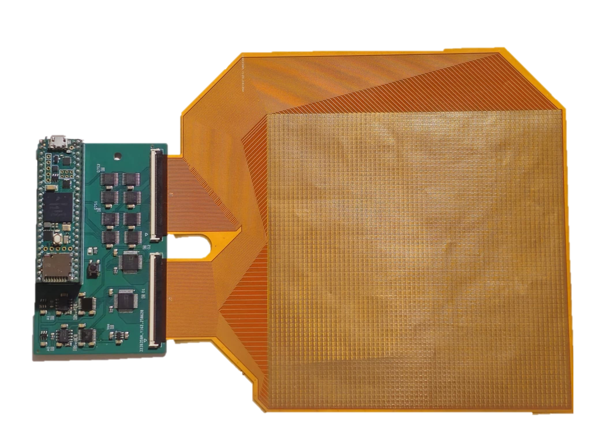
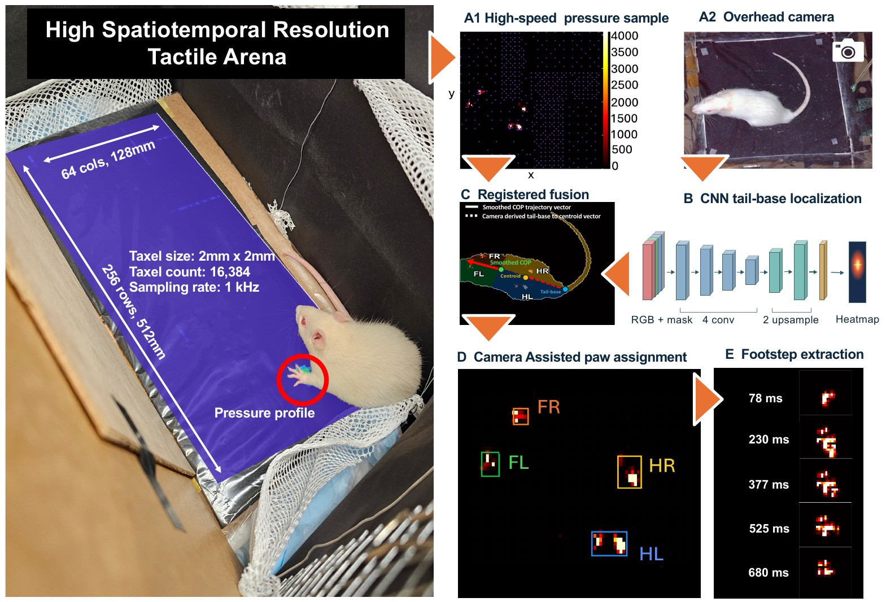
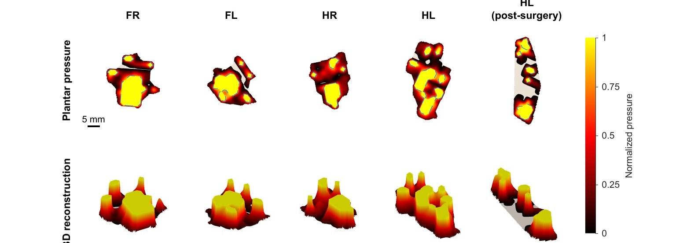
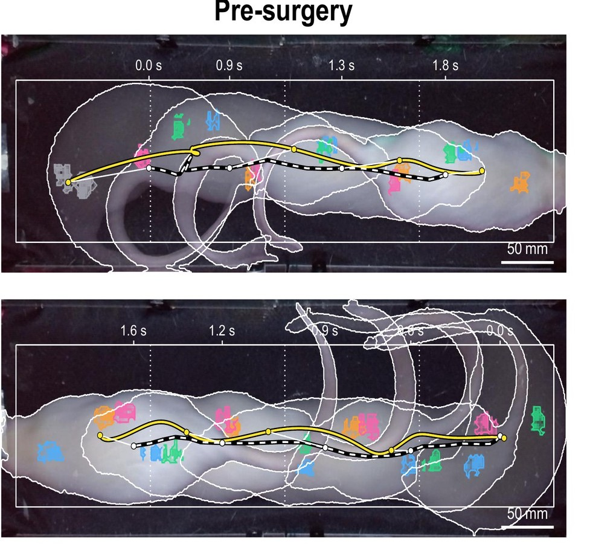
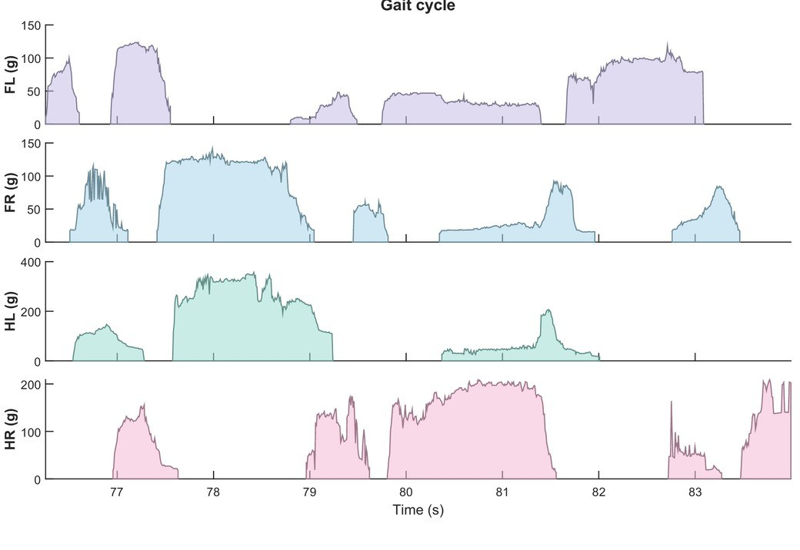

# TactileArena

<!--
  Home page story. Layout classes live in docs/stylesheets/tactilearena.css.
  Numbers here come only from the manuscript (Gait_Project_Paper, main 4.0.tex) and its figures; anything not
  analysed in the paper is labelled as a demonstration.
-->

<section class="ta-section" markdown>
<p class="ta-kicker">The idea</p>

## A camera sees the animal. The floor feels it. { #idea }

<div class="ta-story ta-story--flip" markdown>
<div class="ta-story__text" markdown>

Seen from above, a walking rat hides its paws under its body. Video and pose tracking can say where the body
is and how it moves, but not how much weight each paw carries.

TactileArena puts the measurement where the animal meets the world. The floor is a dense grid of pressure
sensors (taxels), so every contact appears as an image of the paw pressing down, frame by frame. The camera
supplies the body's position and orientation, and the floor supplies the forces.

In one recording you get the familiar gait measures, such as when each paw lands and how long it stays down.
You also get what video cannot see: how hard each paw pushes, how weight shifts between paws, and how load moves
across a single paw during a step.

</div>
<figure class="ta-media" markdown>
<span class="ta-badge">Real data · 0.25× speed</span>
<video width="1920" height="1084" data-loop muted loop playsinline preload="none" data-poster="assets/loops/camera_floor.jpg"
       aria-label="Top: overhead camera view of a walking rat whose paws are hidden under its body. Bottom: the same moment on the tactile floor, where each paw is a distinct, labelled pressure contact.">
  <source src="assets/loops/camera_floor.mp4" type="video/mp4">
</video>
</figure>
</div>

<p class="ta-small">The same walk seen by the overhead camera (top) and by the floor (bottom), both mapped to sensor coordinates.
Labels are the analysis pipeline's automatic paw assignments:
<span class="ta-paw ta-paw--FL">FL</span> left fore, <span class="ta-paw ta-paw--FR">FR</span> right fore,
<span class="ta-paw ta-paw--HL">HL</span> left hind, <span class="ta-paw ta-paw--HR">HR</span> right hind.</p>

<div class="ta-numbers">
  <div class="ta-number"><b>16,384</b><span>taxels, from four 64&nbsp;&times;&nbsp;64 modules</span></div>
  <div class="ta-number"><b>2&nbsp;mm</b><span>taxel pitch, enough to resolve the shape of a rat's paw print</span></div>
  <div class="ta-number"><b>512&nbsp;&times;&nbsp;128</b><span>mm sensing surface, the length of a gait runway</span></div>
  <div class="ta-number"><b>~1&nbsp;kHz</b><span>frame rate (nominal), enough to follow load within a single step</span></div>
  <div class="ta-number"><b>4.9%</b><span>of each module's taxels read per frame (200 of 4,096); the rest is skipped until something presses</span></div>
</div>
</section>

<section class="ta-section" markdown>
<p class="ta-kicker">Why it matters</p>

## Stepping on a paw is not the same as standing on it { #why }

<div class="ta-story ta-story--top" markdown>
<div class="ta-story__text" markdown>

We tracked rats for two weeks after a pinch injury to the left sciatic nerve (three injured, two sham-operated).
In the first days after surgery, the injured animals kept placing the injured hind paw on the ground. Timing
alone showed a moderate deficit, but the loading measured by the floor showed a much larger one.

<div class="ta-finding">
  <div class="ta-finding__card"><b>&minus;0.33</b><span><em>Timing.</em> Change in the left-to-right hindpaw duty-factor ratio (how long the injured paw stays down) on days 1&ndash;5.</span></div>
  <div class="ta-finding__card ta-finding__card--touch"><b>&minus;0.61</b><span><em>Loading.</em> Change in the left-to-right time-integrated loading ratio (how much weight it carries over each stance) on days 1&ndash;5.</span></div>
</div>

Both ratios start near 1, so the paw's share of stance time fell by about a third while its share of load fell by
about 60%. The rats kept using the paw but bore much less weight on it. At the same time, peak loading of the
injured paw dropped by 27% and the opposite hind paw took up 18&ndash;21% more. Both ratios had moved back toward
baseline by days 11&ndash;13.

<p class="ta-small">Model estimates from the manuscript (mixed-effects models, p&nbsp;&lt;&nbsp;0.001 for both ratio changes). The cohort is small and all tests are exploratory; see <a href="results/#injury">Results</a> for details and limitations.</p>

</div>
<figure class="ta-fig" markdown>
{ loading=lazy }
<figcaption>Hindpaw ratios (injured over uninjured side) before and after surgery. Thin lines are individual rats, thick lines group means; stars mark within-group differences from baseline (unadjusted). From Fig. 5d of the manuscript.</figcaption>
</figure>
</div>
</section>

<section class="ta-section" markdown>
<p class="ta-kicker">How it works</p>

## Large, dense and fast, without reading every taxel { #how }

Big pressure-sensing surfaces usually force a trade-off between area, spatial resolution and speed: reading
thousands of taxels one by one takes time. TactileArena avoids the trade-off by reading each taxel only when it
is likely to matter.

<div class="ta-cards" markdown>
<div class="ta-card" markdown>
<div class="ta-media ta-media--contain" markdown>{ loading=lazy }</div>
<div class="ta-card__body" markdown>
<span class="ta-card__num">01 · SENSE</span>

### A floor made of modules

Each module is a flex circuit with a 64&nbsp;&times;&nbsp;64 grid of electrodes under a piezoresistive film,
covered by a waterproof cloth. Pressure lowers the film's resistance at that spot. Four modules, each with its
own readout board, tile the 512&nbsp;mm runway.
</div>
</div>
<div class="ta-card" markdown>
<div class="ta-media" markdown>
<video width="512" height="512" data-loop muted loop playsinline preload="none" data-poster="assets/loops/sampling.jpg" aria-label="Animation of the taxels a module reads in successive frames: a sparse, shifting background scan plus dense patches around each paw.">
  <source src="assets/loops/sampling.mp4" type="video/mp4">
</video>
</div>
<div class="ta-card__body" markdown>
<span class="ta-card__num">02 · SAMPLE</span>

### Look where the action is

Each board reads 200 of its 4,096 taxels per frame. A coarse background scan, shifted every frame, watches the
whole module. Any reading above threshold triggers full-resolution reads of its neighbours, so a paw is
captured completely while empty floor costs almost nothing.

[Try it yourself](how-it-works.md#sampling){ .ta-more }
</div>
</div>
<div class="ta-card" markdown>
<div class="ta-media" markdown>{ loading=lazy }</div>
<div class="ta-card__body" markdown>
<span class="ta-card__num">03 · FUSE</span>

### Pressure meets video

An overhead camera records on the same clock. Registration maps it onto the sensor grid, and a small network
finds the tail base to give body orientation. Contacts are then assigned to paws: 93.3% of 2,469 hand-labelled
contacts were found and given the right paw.

[The analysis pipeline](how-it-works.md#pipeline){ .ta-more }
</div>
</div>
</div>
</section>

<section class="ta-section" id="overview" markdown>
<p class="ta-kicker">Overview video</p>

## TactileArena in two minutes

<figure class="ta-media" markdown>
<video width="1920" height="1080" controls preload="none" playsinline data-poster="assets/video/overview.jpg"
       aria-label="Overview video of TactileArena with on-screen captions">
  <source src="assets/video/overview.mp4" type="video/mp4">
  <track kind="captions" src="assets/video/overview.vtt" srclang="en" label="English">
</video>
</figure>
</section>

<section class="ta-section" markdown>
<p class="ta-kicker">What you can measure</p>

## From the whole animal down to a single step { #measures }

The same recording supports measurements at three scales: movement along the arena, load sharing between the
four paws, and pressure dynamics within each paw contact.

<div class="ta-cards" markdown>
<div class="ta-card" markdown>
<div class="ta-media ta-media--white" markdown>{ loading=lazy }</div>
<div class="ta-card__body" markdown>
### Footprints and timing
Paw-resolved pressure maps, contact area and shape, stance and swing for all four limbs. After injury, the
injured hind paw's print became smaller and more elongated.
</div>
</div>
<div class="ta-card" markdown>
<div class="ta-media" markdown>{ loading=lazy }</div>
<div class="ta-card__body" markdown>
### Where the weight is
The whole-animal centre of pressure tracks how the body's weight is distributed over its supports, which
is not the same as the body's outline seen by the camera.
</div>
</div>
<div class="ta-card" markdown>
<div class="ta-media ta-media--white" markdown>{ loading=lazy }</div>
<div class="ta-card__body" markdown>
### Load within each step
Mass-equivalent loading for every paw at about 1&nbsp;kHz. Speed matters for short contacts: for stances of
0.2&ndash;0.5&nbsp;s, cumulative-loading error stayed below 2% down to 50&nbsp;Hz but rose to about 10% at 10&nbsp;Hz.
</div>
</div>
</div>

[All results](results.md){ .ta-more }
</section>

<section class="ta-section" markdown>
<p class="ta-kicker">Beyond the runway</p>

## The modules can tile other arenas { #beyond }

<div class="ta-story" markdown>
<div class="ta-story__text" markdown>

The sensing surface is assembled from independent modules, so the same hardware can cover other shapes. Here,
the four modules are tiled into a square open field with three rats at once.

Possible next steps, none of which the paper has tested yet:

- larger or differently shaped arenas, and other species, after recalibration;
- pairing contact measurements with markerless pose estimation, to relate load to limb and body posture;
- synchronized neural or muscle recordings, to tie each step's mechanics to sensorimotor control, and perturbations triggered at specific phases of contact;
- shear sensing at the same resolution, to add tangential forces.

<p class="ta-note">Demonstration recordings: the square arena and multi-animal clips were not analysed in the paper.</p>

</div>
<figure class="ta-media" markdown>
<span class="ta-badge">Demonstration · not analysed in the paper</span>
<video width="1600" height="900" data-loop muted loop playsinline preload="none" data-poster="assets/video/arena_multi.jpg"
       aria-label="Three rats on a square tactile arena built from four modules; left, the live tactile map with their paw contacts; right, the overhead camera.">
  <source src="assets/video/arena_multi.mp4" type="video/mp4">
</video>
</figure>
</div>
</section>

<section class="ta-section" markdown>
<p class="ta-kicker">Open</p>

## Build it, run it, reuse the data { #open }

<div class="ta-cards" markdown>
<div class="ta-card" markdown>
<div class="ta-card__body" markdown>
### Build guide
Four flex-PCB sensor modules, four readout boards built around a Teensy 4.1, a piezoresistive film and a
waterproof cover: about US$540 in parts for one runway, or roughly US$135 per module. Includes an assembly video.

[Build one](build.md){ .ta-more }
</div>
</div>
<div class="ta-card" markdown>
<div class="ta-card__body" markdown>
### Code
Readout firmware, synchronized pressure and video recording, and the MATLAB/Python analysis pipeline, with a
pretrained tail-base network, calibration curves and a demo that checks its own output. MIT licence.

[Software](software.md){ .ta-more }
</div>
</div>
<div class="ta-card" markdown>
<div class="ta-card__body" markdown>
### Data
All 85 runway recordings from the study, with raw pressure packets, overhead video and the original
annotations: homographies, blind manual paw labels, walking windows and body mass.

[Data](data.md){ .ta-more }
</div>
</div>
</div>
</section>

<section class="ta-section" markdown>

## Cite { #cite }

The manuscript is in preparation. Until it is published, please cite this website and the code:

<div class="ta-cite" markdown>

```bibtex
@misc{tactilearena2026,
  title  = {Scalable high-density tactile arenas for measuring ground-contact forces in freely moving animals},
  author = {Lu, Weiwen and Slepyan, Ariel and Perkins, Pierce and Ascani Orsini, Alessandro and Quinn, Kiara and Thakor, Nitish V.},
  year   = {2026},
  note   = {Manuscript in preparation},
  url    = {https://tactilearena.github.io}
}
```

</div>
</section>
