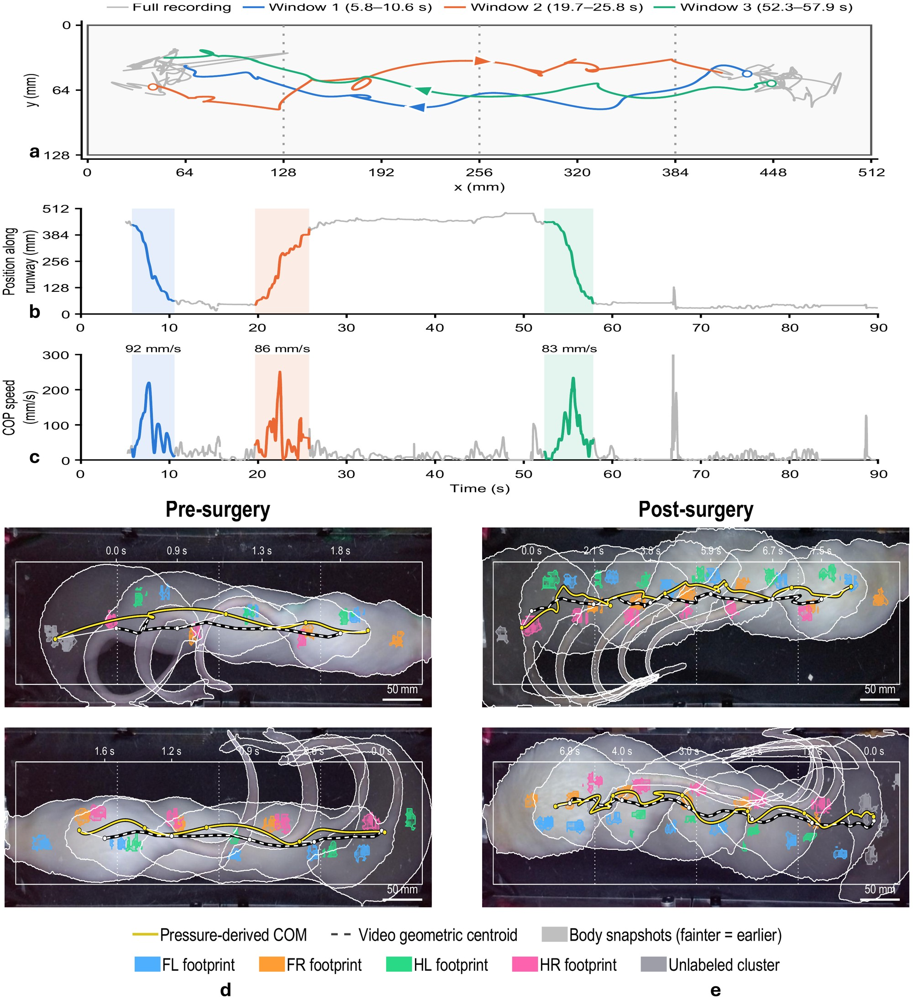

# Results

A summary of the manuscript's findings, figure by figure. Numbers are as reported in the
manuscript. The biological study is a small, exploratory cohort, described with its limitations below.

## Pressure imaging captures every paw during free walking { #contacts }

<figure class="ta-fig" markdown>
{ loading=lazy }
<figcaption><strong>Fig. 3.</strong> a, Detected contacts on synchronized video frames. b, Plantar pressure maps for each paw, including a post-surgery left hindpaw that suggests the rat was also bearing weight on its heel. c, A footprint trail at maximum contact area. d, Stance intervals for all four paws.</figcaption>
</figure>

Projecting detected contacts onto the video shows each paw's position relative to the animal throughout a walk.
Each contact is an image, so the shape of the print and the distribution of pressure within it are measured
along with its timing. In one recording, a rat's successive contacts form a footprint trail and a stance diagram
for all four limbs.

## The centre of pressure is not the centre of the body { #cop }

<figure class="ta-fig" markdown>
{ loading=lazy }
<figcaption><strong>Fig. 2.</strong> a&ndash;c, Whole-animal centre of pressure (COP) over a recording, its position along the runway and its speed in three walking windows. d,e, COP (yellow) and the video body centroid (white dashed) in illustrative walks before and after surgery.</figcaption>
</figure>

The whole-animal COP describes how weight is spread across the supporting paws. It followed the video body
centroid during walking, but the two are different quantities: one is the pressure-weighted centre of the
surface loading, the other the centre of the body outline seen by the camera. In the illustrated windows, COP
paths after surgery looked more irregular. That observation was not quantified across animals.

## Speed matters for short contacts { #sampling }

<figure class="ta-fig" markdown>
{ loading=lazy }
<figcaption><strong>Fig. 4.</strong> a, Paw-specific loading in mass-equivalent grams. b, One trace at its native 1,009&nbsp;Hz and downsampled. c,d, COP speed and stance-duration distributions before and after surgery. e,f, Cumulative-loading error relative to the native trace.</figcaption>
</figure>

Paw-specific traces resolve loading and unloading within each stance. When recordings were downsampled, the
cumulative-loading error grew as the sampling rate fell, and most for the shortest contacts. For stances of
0.2&ndash;0.5&nbsp;s it stayed below 2% down to 50&nbsp;Hz but rose to about 10% at 10&nbsp;Hz. The acquisition rate
should be chosen for the contact durations and measures of interest. This analysis covers loading traces and
their integrals, not COP trajectories.

## Automatic paw assignment { #decoder }

Within manually selected walking windows from 81 recordings, the camera-assisted pipeline identified
**2,303 of 2,469** hand-labelled contacts correctly (93.3%). Of the reference contacts, 2,406 were matched to an
automatic contact (95.7% label agreement among those), 63 were missed and 103 were given the wrong paw. This
measures contact matching and paw assignment within curated windows, not the automatic selection of walking
bouts ([Supplementary Fig. S2](how-it-works.md#pipeline)).

## After sciatic nerve injury, rats unload the injured paw { #injury }

<figure class="ta-fig" markdown>
{ loading=lazy }
<figcaption><strong>Fig. 5.</strong> Three rats with a left sciatic nerve pinch (SNI) and two sham-operated rats, before surgery and over the following two weeks. a,b, Contact shapes through a gait cycle. c, Contact area and length-to-width ratio. d, Hindpaw duty-factor and time-integrated loading ratios. e,f, Peak response relative to each paw's baseline. g,h, Hindpaw loading imbalance.</figcaption>
</figure>

- **Footprint shape.** The injured left hind paw's contact area decreased and its length-to-width ratio increased after surgery. Changes were milder in sham rats and uninjured paws.
- **Timing versus loading.** Relative to baseline, the left-to-right hindpaw duty-factor ratio fell by 0.33 on days 1&ndash;5 and 0.31 on days 8&ndash;10, while the time-integrated loading ratio fell by 0.61 and 0.56 (all p&nbsp;&lt;&nbsp;0.001). Both ratios had moved back toward baseline by days 11&ndash;13 (no longer significantly different). Neither changed significantly in sham rats.
- **Which paws.** The injured hind paw's peak response fell by 27% on days 1&ndash;5 (p&nbsp;&lt;&nbsp;0.001) and 16% on days 8&ndash;10 (p&nbsp;=&nbsp;0.009). The opposite hind paw's rose by 18% (p&nbsp;=&nbsp;0.037) and 21% (p&nbsp;=&nbsp;0.008). Forepaws in SNI rats and all paws in sham rats showed no significant changes.
- **Imbalance.** During hindpaw-only support, session-level loading shifted toward the right side in all three SNI rats, with evidence varying by animal and epoch.

Taken together, the rats kept placing the injured paw but carried much less weight on it, and shifted load to
the opposite hind paw. Within-paw COP paths further suggested delayed forward load transfer in the injured hind
paw ([Supplementary Fig. S3](#within-paw)). That timing observation is exploratory, but it is a feature that
systems with lower sampling rates would struggle to capture.

<figure class="ta-media" markdown>
Before surgery · 0.25× speed
<video controls muted playsinline preload="none" data-poster="assets/video/pre-surgery.jpg" aria-label="Annotated recording before surgery: overhead camera with labelled paw contacts above 3D pressure surfaces for each paw">
  <source src="assets/video/pre-surgery.mp4" type="video/mp4">
</video>
</figure>
<figure class="ta-media" markdown>
After surgery · 0.25× speed
<video controls muted playsinline preload="none" data-poster="assets/video/post-surgery.jpg" aria-label="Annotated recording after surgery: overhead camera with labelled paw contacts above 3D pressure surfaces for each paw">
  <source src="assets/video/post-surgery.mp4" type="video/mp4">
</video>
</figure>

Annotated recordings from the analysis pipeline: rat 6 before surgery (11 February 2026) and rat 4 after surgery (19 March 2026). Each panel shows one paw's pressure as a surface while it is in stance.

## Within-paw centre of pressure { #within-paw }

<figure class="ta-fig" markdown>
{ loading=lazy }
<figcaption><strong>Supplementary Fig. S3.</strong> a,b, Pressure under one paw through stance, with the paw-level COP path. c,d, Anterior&ndash;posterior and medio-lateral COP displacement over stance, 949 hand-labelled prints. Net displacement at lift-off did not differ significantly between groups after surgery.</figcaption>
</figure>

## Limitations { #limitations }

- **Cohort.** Three SNI and two sham rats cannot establish population-level specificity or reproducibility. Statistical tests are exploratory and unadjusted for multiple comparisons, and walking speed, which strongly affects rodent gait, was not controlled for.
- **Labels.** Automatic paw assignment was evaluated within manually selected walking bouts. The biological analyses used manually corrected labels.
- **Force.** Calibration was per board on summed responses (held-out errors 23.4&ndash;30.6&nbsp;g). The film measures normal load only, so braking, propulsion and paw-level shear would need additional sensing.
- **Scope.** Turning, overlapping contacts and prolonged spontaneous behaviour need broader validation.
