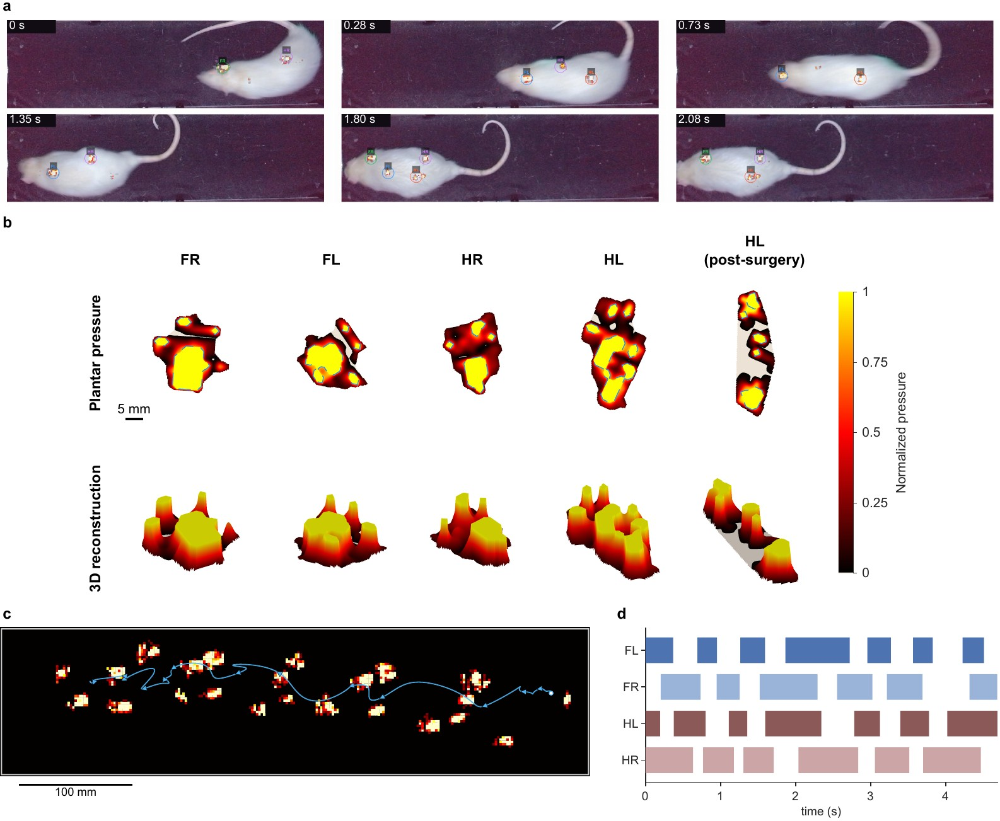
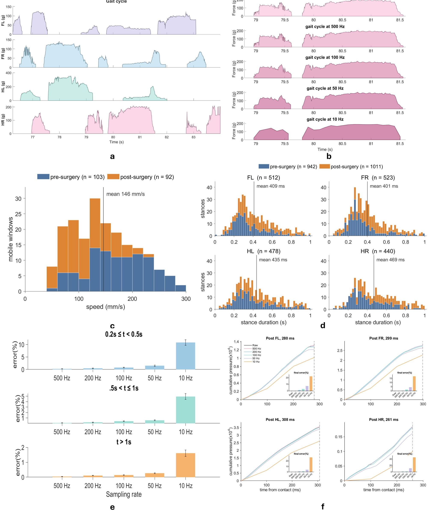
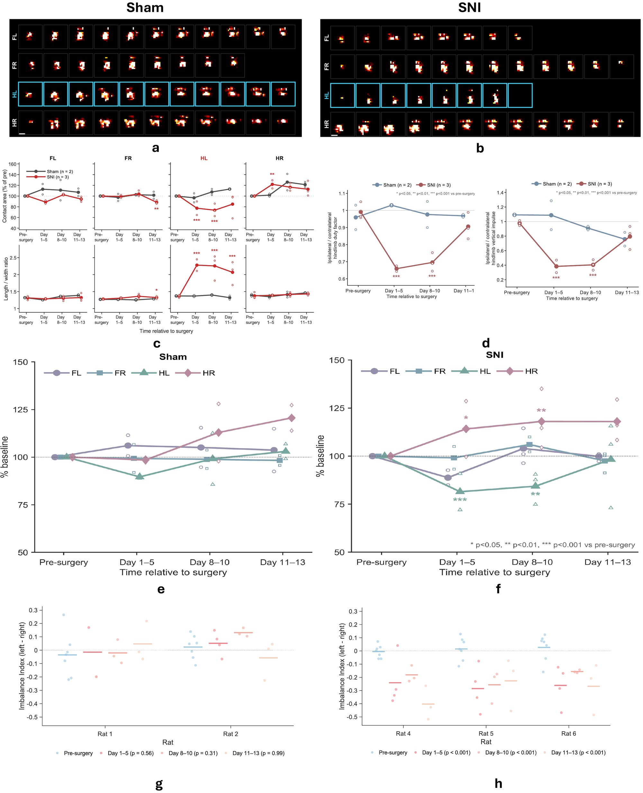
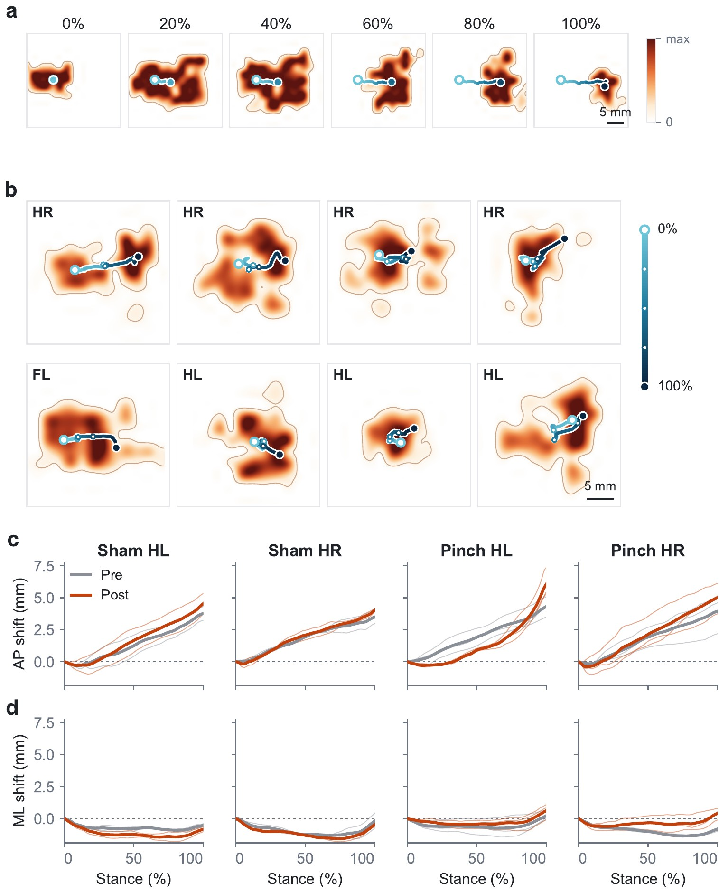

# Results

Summary of the principal findings of the manuscript, by figure. All values are as reported in
the manuscript.

## Pressure imaging resolves individual paw contacts during free walking { #contacts }

<figure class="ta-fig" markdown>
{ loading=lazy }
<figcaption><strong>Fig. 2.</strong> a, Detected paw contacts projected onto synchronized overhead video frames. b, Plantar pressure maps for each paw, including a postoperative left hindpaw contact indicating additional support on the heel. c, Footprint trail at maximum contact area. d, Stance intervals for all four paws.</figcaption>
</figure>

Projection of detected contacts onto the synchronized video locates each paw relative to the animal throughout a
walking sequence. Because each contact is recorded as a pressure image, the geometry of the footprint and the
distribution of pressure within it are measured together with contact timing. Within a single recording,
successive contacts form a footprint trail and a stance diagram for all four limbs.

## Whole-animal centre of pressure { #cop }

<figure class="ta-fig" markdown>
{ loading=lazy }
<figcaption><strong>Fig. 3.</strong> a&ndash;c, Whole-animal centre of pressure (COP) over a recording, its position along the runway and its speed within three walking windows. d,e, COP (yellow) and video-derived body centroid (white, dashed) in presurgical and postsurgical walking sequences.</figcaption>
</figure>

The whole-animal COP describes how body weight is distributed across the supporting paws. It followed the
video-derived body centroid during walking, although the two describe distinct quantities: the pressure-weighted
centre of surface loading and the centre of the body contour observed by the camera. In the illustrated windows,
postsurgical COP trajectories were more irregular, with more pronounced local curvature and changes in direction,
suggesting altered weight-transfer patterns after injury.

## Effect of sampling rate on loading measurements { #sampling }

<figure class="ta-fig" markdown>
{ loading=lazy }
<figcaption><strong>Fig. 4.</strong> a, Paw-specific loading in mass-equivalent grams. b, Loading trace at its native 1,009&nbsp;Hz and downsampled. c,d, COP-speed and stance-duration distributions before and after surgery. e,f, Cumulative-loading error relative to the native trace.</figcaption>
</figure>

Paw-specific traces resolve loading and unloading within each stance. In downsampled recordings, cumulative-loading
error increased as the sampling rate decreased and was greatest for the shortest contacts: for stances of
0.2&ndash;0.5&nbsp;s, it remained below 2% down to 50&nbsp;Hz and increased to approximately 10% at 10&nbsp;Hz. The
acquisition rate should therefore be matched to contact duration and the measure of interest.

## Camera-assisted paw assignment { #decoder }

Within manually selected walking windows from 81 recordings, the camera-assisted pipeline correctly identified
**2,303 of 2,469** manually annotated contacts (93.3%). Of the reference contacts, 2,406 were matched to an
automatically detected contact (95.7% label agreement among matched contacts), 63 were unmatched and 103 were
assigned an incorrect paw identity ([Supplementary Fig. S2](how-it-works.md#pipeline)).

## Altered hindlimb loading after sciatic nerve pinch { #injury }

<figure class="ta-fig" markdown>
{ loading=lazy }
<figcaption><strong>Fig. 5.</strong> Three rats with left sciatic nerve pinch injury (SNI) and two sham-operated rats, recorded before surgery and over the following two weeks. a,b, Contact shapes through a postoperative gait cycle. c, Contact area relative to baseline and footprint length-to-width ratio for each paw. d, Left-to-right hindpaw duty-factor and time-integrated loading ratios. e,f, Body-mass-normalized peak loading relative to each rat's presurgical median for that paw. g,h, Hindpaw imbalance, (L&minus;R)/(L+R), during hindpaw-only support.</figcaption>
</figure>

- **Footprint morphology.** In SNI rats, the contact area of the injured left hindpaw decreased to approximately 77% and 74% of baseline on days 1&ndash;5 and 8&ndash;10 (both p&nbsp;&lt;&nbsp;0.001) and was 85% of baseline on days 11&ndash;13 (p&nbsp;=&nbsp;0.064); its length-to-width ratio increased by 49%, 56% and 40% across the three postoperative epochs (all p&nbsp;&lt;&nbsp;0.001). The contact area of the contralateral hindpaw increased to approximately 122% of baseline on days 1&ndash;5 (p&nbsp;=&nbsp;0.009). No morphology measure changed significantly in sham-operated rats.
- **Gait timing and loading.** Relative to baseline, the left-to-right hindpaw duty-factor ratio decreased by 0.33 on days 1&ndash;5 and 0.30 on days 8&ndash;10, whereas the time-integrated loading ratio decreased by 0.59 and 0.54 (all p&nbsp;&lt;&nbsp;0.001). By days 11&ndash;13, neither ratio differed significantly from baseline (p&nbsp;=&nbsp;0.305 and 0.918). Neither ratio differed significantly from baseline in sham-operated rats.
- **Paw-specific loading.** Peak loading of the injured hindpaw decreased by 27% on days 1&ndash;5 (p&nbsp;&lt;&nbsp;0.001) and by 18% on days 8&ndash;10 (p&nbsp;=&nbsp;0.026), whereas that of the contralateral hindpaw increased by 22% (p&nbsp;=&nbsp;0.019) and 23% (p&nbsp;=&nbsp;0.006). Forepaws of SNI rats and all paws of sham-operated rats showed no significant changes.
- **Hindlimb imbalance.** During hindpaw-only support, as in rearing, the imbalance index shifted toward right-sided loading in all three SNI rats, decreasing by 0.28, 0.21 and 0.31 on days 1&ndash;5, 8&ndash;10 and 11&ndash;13 (all p&nbsp;&lt;&nbsp;0.001); the injured hindpaw carried approximately 35&ndash;40% of the hindlimb load, compared with approximately 50% before surgery. Sham-operated rats showed no significant change.

Together, these results indicate that the rats continued to place the injured paw while bearing substantially less
weight on it, with compensatory loading of the contralateral hindpaw. Paw-specific COP trajectories further
suggested delayed anterior load transfer in the injured hindpaw, and the net COP displacement at lift-off shifted
by up to approximately 1.4&nbsp;mm after surgery, mainly in the contralateral hindpaw
([Supplementary Fig. S3](#within-paw)).

<figure class="ta-media" markdown>
Before surgery · 0.25× speed
<video width="1280" height="1000" controls muted playsinline preload="none" data-poster="../assets/video/pre-surgery.jpg" aria-label="Annotated recording before surgery: overhead video with labelled paw contacts above three-dimensional pressure surfaces for each paw">
  <source src="../assets/video/pre-surgery.mp4" type="video/mp4">
</video>
</figure>
<figure class="ta-media" markdown>
After surgery · 0.25× speed
<video width="1280" height="1000" controls muted playsinline preload="none" data-poster="../assets/video/post-surgery.jpg" aria-label="Annotated recording after surgery: overhead video with labelled paw contacts above three-dimensional pressure surfaces for each paw">
  <source src="../assets/video/post-surgery.mp4" type="video/mp4">
</video>
</figure>

Supplementary Videos 2 and 3: annotated recordings produced by the analysis pipeline for rat 6 before surgery (11 February 2026) and rat 4 nine days after surgery (19 March 2026). Each lower panel shows the pressure distribution of one paw during stance.

## Within-paw centre of pressure { #within-paw }

<figure class="ta-fig" markdown>
{ loading=lazy }
<figcaption><strong>Supplementary Fig. S3.</strong> a,b, Pressure distribution under one paw through stance, with the paw-level COP trajectory. c,d, Anterior&ndash;posterior and medio-lateral COP displacement over stance before and after surgery in sham-operated (n&nbsp;=&nbsp;2) and pinch-injured (n&nbsp;=&nbsp;3) rats (910 manually labelled footprints). In pinch-injured rats, net displacement at lift-off shifted laterally by 0.7&nbsp;mm in the left hindpaw (p&nbsp;=&nbsp;0.032) and anteriorly by 1.4&nbsp;mm (p&nbsp;=&nbsp;0.026) and laterally by 0.9&nbsp;mm (p&nbsp;=&nbsp;0.019) in the right hindpaw; sham-operated rats showed no significant change. After surgery, anterior&ndash;posterior COP progression also changed in timing, with slower progression after initial contact and a sharper shift before lift-off.</figcaption>
</figure>

## Limitations { #limitations }

- **Cohort.** The cohort of three SNI and two sham-operated rats was designed to demonstrate feasibility for longitudinal study rather than to establish the specificity or reproducibility of each observed change; walking speed may have contributed to some differences.
- **Paw labels.** Within curated walking windows, automated paw assignment mislabelled 4.2% and missed 2.6% of manually annotated contacts; the biological analyses used manually corrected labels, and walking-window selection and camera-to-sensor registration were curated manually.
- **Force.** Calibration was performed per board on summed responses (held-out errors of 23.4&ndash;30.6&nbsp;g). The film measures normal load; tangential forces would require additional sensing.
- **Scope.** Turning, overlapping contacts and prolonged spontaneous behaviour require broader validation.
